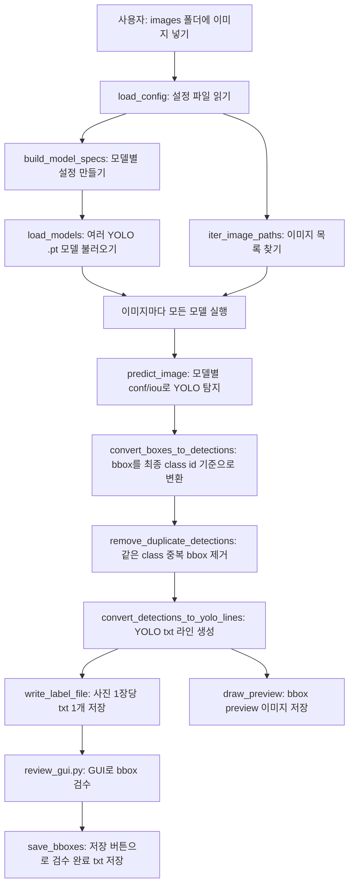

# auto_label.py 코드 설명

이 문서는 현재 MVP의 자동 라벨링 1단계를 설명한다. 설명 기준은 함수 책임과 데이터 흐름이다.

## 1. 업무의 큰틀

업무 정의:
- 사람이 직접 bbox를 그리기 전에, 학습된 YOLO `.pt` 모델들이 이미지에서 객체 후보 bbox를 먼저 만든다.

현재 자동화 범위:
- 여러 YOLO 모델을 순서대로 실행한다.
- 각 모델은 자기 설정 안의 `conf`, `iou`를 사용한다.
- 모델별 bbox를 최종 class id로 변환한다.
- 같은 class끼리 많이 겹치는 bbox는 하나만 남긴다.
- 사진 1장에 대해 최종 결과를 하나의 YOLO txt 파일로 저장한다.
- bbox가 그려진 preview 이미지를 저장한다.

아직 구현되지 않은 범위:
- 데이터베이스 저장

최종 출력:
- `labels_auto/*.txt`
- `labels_reviewed/*.txt`
- `previews/*.jpg`

## 2. 전체 흐름



## 3. 단계별 기능 지도

| 단계 | 사용자 행동 | 담당 파일/함수 | 입력 데이터 | 출력 데이터/저장 위치 | 구현 상태 | 수정 지점 |
|---|---|---|---|---|---|---|
| 설정 준비 | 설정 파일 작성 | `autolabel_config.yaml` | 모델 경로, 모델별 임계값, class 매핑, 중복 제거 기준 | 실행 설정 | 구현됨 | 모델 추가/삭제는 `models` 수정 |
| 설정 읽기 | 실행 명령 입력 | `load_config` | YAML 설정 파일 | 검증된 설정값 | 구현됨 | 필수 설정 항목은 `load_config` 수정 |
| 모델 설정 구성 | 없음 | `build_model_specs` | 검증된 설정값 | 실행할 모델 목록 | 구현됨 | 모델 설정 규칙은 `build_model_specs` 수정 |
| 모델 로드 | 없음 | `load_models`, `load_model` | 모델 목록 | YOLO 모델 객체 목록 | 구현됨 | 모델 로드 방식은 `load_model` 수정 |
| 이미지 찾기 | 이미지 폴더에 파일 배치 | `iter_image_paths` | 이미지 폴더 | 이미지 파일 목록 | 구현됨 | 지원 확장자는 `IMAGE_EXTENSIONS` 수정 |
| 자동 탐지 | 없음 | `predict_image` | YOLO 모델, 이미지, 모델별 임계값 | YOLO 탐지 결과 | 구현됨 | 추론 옵션은 `predict_image` 수정 |
| bbox 변환 | 없음 | `convert_boxes_to_detections` | YOLO 탐지 결과, class 매핑 | 최종 class id 기준 bbox 목록 | 구현됨 | class id 변환은 `class_map` 또는 함수 수정 |
| 중복 제거 | 없음 | `remove_duplicate_detections` | bbox 목록, 중복 제거 기준 | 중복 제거된 bbox 목록 | 구현됨 | 중복 제거 정책은 이 함수 수정 |
| txt 변환 | 없음 | `convert_detections_to_yolo_lines` | 중복 제거된 bbox 목록 | YOLO txt 라인 목록 | 구현됨 | txt 출력 형식은 이 함수 수정 |
| txt 저장 | 없음 | `write_label_file` | YOLO txt 라인 목록 | `labels_auto/*.txt` | 구현됨 | 저장 방식은 `write_label_file` 수정 |
| preview 저장 | 없음 | `draw_preview` | 이미지, YOLO txt 라인, class 이름 | `previews/*.jpg` | 구현됨 | preview 표시 방식은 `draw_preview` 수정 |
| 검수 시작 | GUI 실행 | `ReviewApp` | 이미지, `labels_auto/*.txt` | 검수중 bbox 목록 | 구현됨 | 검수 화면은 `review_gui.py` 수정 |
| bbox 추가 | 마우스로 드래그 | `create_bbox` | 새 bbox | 검수중 bbox 목록 | 구현됨 | 추가 규칙은 `review_labels.py` 수정 |
| bbox 수정 | class 변경 | `change_bbox_class` | 선택 bbox, class | 검수중 bbox 목록 | 부분 구현 | 위치 수정은 다음 단계 |
| bbox 삭제 | 삭제 버튼 클릭 | `delete_bbox` | 선택 bbox | 검수중 bbox 목록 | 구현됨 | 삭제 규칙은 `review_labels.py` 수정 |
| 검수 저장 | 저장 버튼 클릭 | `save_bboxes` | 검수중 bbox 목록 | `labels_reviewed/*.txt` | 구현됨 | 저장 위치는 설정 파일 수정 |

## 4. 여러 모델 설정

설정 예:

```yaml
models:
  - name: person
    path: models/person.pt
    conf: 0.25
    iou: 0.70
    class_map:
      0: 0

  - name: heavy_equipment
    path: models/heavy_equipment.pt
    conf: 0.40
    iou: 0.70
    class_map:
      0: 1

duplicate_iou: 0.90

classes:
  - person
  - heavy_equipment
```

의미:
- `person.pt`는 `conf: 0.25`, `iou: 0.70`으로 실행된다.
- `heavy_equipment.pt`는 `conf: 0.40`, `iou: 0.70`으로 실행된다.
- `person.pt` 모델이 탐지한 내부 0번 class는 최종 txt에서 0번으로 저장된다.
- `heavy_equipment.pt` 모델이 탐지한 내부 0번 class는 최종 txt에서 1번으로 저장된다.
- 같은 class bbox끼리 0.90 이상 겹치면 confidence가 높은 bbox만 남는다.

사진 1장에 사람 1명과 중장비 1대가 있으면 txt는 한 파일에 여러 줄로 저장된다.

```text
0 0.512300 0.431200 0.182100 0.442000
1 0.721000 0.604000 0.310000 0.280000
```

## 5. 핵심 함수 상세

### `load_config`

목적:
- 자동 라벨링 설정 파일을 읽고, 실행에 필요한 항목이 있는지 확인한다.

입력 데이터:
- YAML 설정 파일

반환값:
- 검증된 설정값

실패 지점:
- 설정 파일이 없음
- YAML 구조가 잘못됨
- 필수 설정 항목이 없음

### `build_model_specs`

목적:
- 설정값에 적힌 여러 모델을 실행 가능한 모델 목록으로 바꾼다.

입력 데이터:
- 검증된 설정값
- 설정 파일 기준 경로

중간 데이터:
- 모델 이름
- 모델 파일 경로
- 모델별 `conf`, `iou`
- 모델 내부 class id와 최종 class id의 매핑

반환값:
- 실행할 모델 목록

실패 지점:
- 모델 목록이 비어 있음
- 모델 경로가 없음
- 모델별 `conf`, `iou`가 없음
- class 매핑이 없음

이 동작을 바꾸려면:
- 모델 추가/삭제/임계값 변경은 `autolabel_config.yaml`의 `models`를 수정한다.
- 모델 설정 규칙 자체를 바꾸려면 `build_model_specs`를 수정한다.

### `load_models`

목적:
- 모델 설정 목록을 실제 YOLO 모델 객체 목록으로 불러온다.

입력 데이터:
- 실행할 모델 목록

반환값:
- YOLO 모델 객체 목록

실패 지점:
- `.pt` 파일이 없음
- 모델 파일이 손상됨
- Ultralytics/PyTorch 환경 문제

### `predict_image`

목적:
- 이미지 1장에 대해 YOLO 탐지를 실행한다.

입력 데이터:
- YOLO 모델
- 이미지 파일
- 해당 모델의 `conf`, `iou`

반환값:
- YOLO 탐지 결과

실패 지점:
- 이미지 파일 문제
- 모델 추론 환경 문제

### `convert_boxes_to_detections`

목적:
- YOLO 탐지 결과의 bbox를 최종 class id 기준 bbox 목록으로 바꾼다.

입력 데이터:
- YOLO 탐지 결과
- class 매핑

중간 데이터:
- bbox 좌표
- confidence
- 최종 class id

반환값:
- 최종 class id 기준 bbox 목록

이 동작을 바꾸려면:
- 최종 class id를 바꾸려면 `autolabel_config.yaml`의 `class_map`을 수정한다.

### `remove_duplicate_detections`

목적:
- 같은 class끼리 많이 겹치는 bbox를 제거한다.

입력 데이터:
- bbox 목록
- 중복 제거 기준

처리 규칙:
- 같은 class끼리만 비교한다.
- 서로 다른 class는 겹쳐도 유지한다.
- 같은 class에서 많이 겹치면 confidence가 높은 bbox만 남긴다.

반환값:
- 중복 제거된 bbox 목록

이 동작을 바꾸려면:
- 중복 판단 기준은 `autolabel_config.yaml`의 `duplicate_iou`를 수정한다.
- 서로 다른 class까지 제거하려면 `remove_duplicate_detections`를 수정한다.

### `convert_detections_to_yolo_lines`

목적:
- 중복 제거된 bbox 목록을 YOLO txt 라인으로 바꾼다.

입력 데이터:
- 중복 제거된 bbox 목록

반환값:
- YOLO txt 라인 목록

출력 형식:

```text
class_id x_center y_center width height
```

참고:
- confidence는 중복 제거 판단에만 쓰고 txt에는 저장하지 않는다.

### `write_label_file`

목적:
- YOLO txt 라인 목록을 파일로 저장한다.

입력 데이터:
- YOLO txt 라인 목록
- 저장할 txt 파일 경로

출력 데이터:
- `labels_auto/*.txt`

부작용:
- txt 파일을 생성하거나 덮어쓴다.

### `draw_preview`

목적:
- 최종 txt에 들어간 bbox 기준으로 preview 이미지를 만든다.

입력 데이터:
- 원본 이미지
- YOLO txt 라인 목록
- class 이름 목록

출력 데이터:
- `previews/*.jpg`

부작용:
- preview 이미지 파일을 생성하거나 덮어쓴다.

### `ReviewApp`

목적:
- 자동 생성된 YOLO txt를 이미지 위에 표시하고, 사람이 bbox를 검수할 수 있는 로컬 GUI를 실행한다.

입력 데이터:
- 원본 이미지
- `labels_auto/*.txt`
- `classes.txt`

처리:
- 이미지 목록을 보여준다.
- 자동 생성 bbox를 화면에 그린다.
- 마우스 드래그로 bbox를 추가한다.
- 선택한 bbox를 삭제한다.
- 선택한 bbox의 class를 변경한다.
- 저장 버튼을 누르면 검수 완료 txt를 저장한다.

출력 데이터:
- `labels_reviewed/*.txt`

이 동작을 바꾸려면:
- 화면 구성과 버튼 동작은 `review_gui.py`를 수정한다.
- bbox 읽기/쓰기/CRUD 규칙은 `review_labels.py`를 수정한다.

## 6. 실행과 검증

실행 명령:

```powershell
cd C:\Users\suny0\labeling\autolabel_mvp
python auto_label.py --config autolabel_config.yaml
```

검수 GUI 실행 명령:

```powershell
cd C:\Users\suny0\labeling\autolabel_mvp
python review_gui.py --config autolabel_config.yaml
```

테스트 명령:

```powershell
cd C:\Users\suny0\labeling\autolabel_mvp
python -X utf8 -m unittest test_review_labels.py
```

확인할 파일:
- `labels_auto`
- `previews`

기대 결과:
- 사진 1장마다 txt 파일 1개가 생성된다.
- 여러 모델에서 나온 bbox가 같은 txt 파일 안에 여러 줄로 저장된다.
- 같은 class끼리 겹친 bbox는 하나만 남는다.
- 서로 다른 class bbox는 겹쳐도 유지된다.
- preview 이미지에는 중복 제거 후 bbox가 표시된다.
- GUI에서 저장 버튼을 누르면 `labels_reviewed/*.txt`가 생성된다.
