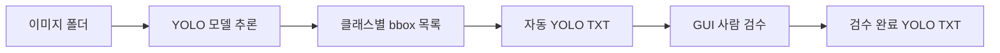

# YOLO 반자동 라벨링 MVP

학습된 YOLO 모델로 이미지의 bbox를 자동 생성하고, 사람이 GUI에서 bbox를
추가·조회·수정·삭제한 뒤 YOLO TXT로 저장하는 로컬 라벨링 도구입니다.

현재 클래스는 `person`과 건설장비 11종을 서로 구분합니다. 클래스마다 GUI의
bbox 색상이 다르며, 검수 결과는 이미지별 TXT 파일로 저장됩니다.

## 설치

```powershell
python -m venv .venv
.\.venv\Scripts\Activate.ps1
pip install -r requirements.txt
Copy-Item autolabel_config.example.yaml autolabel_config.yaml
```

`autolabel_config.yaml`에서 모델 경로와 이미지 폴더를 현재 PC 환경에 맞게
수정합니다. `.pt` 모델과 현장 이미지는 Git 저장소에 포함되지 않습니다.

## 실행

GUI 검수:

```powershell
python review_gui.py --config autolabel_config.yaml
```

폴더 전체 자동 라벨 생성:

```powershell
python auto_label.py --config autolabel_config.yaml
```

## 폴더 전체 자동 라벨 옵션

```powershell
python auto_label.py --config autolabel_config.yaml --skip-existing
```

- `--skip-existing`: 이미 txt가 있는 사진은 건너뛴다. 중단된 작업을 이어서 돌릴 때 쓴다.
- `--quiet`: 사진별 진행률 출력을 끈다.

사진 1장이 손상되어 실패해도 나머지는 계속 처리하고, 끝에 실패 목록을 모아 보여준다.

## 검수 화면

- 다크 테마 + Windows 배율(DPI) 인식: 125%/150% 배율에서도 글자와 사진이 흐려지지 않는다.
- bbox마다 class 색 칩이 붙고, 오른쪽 목록도 같은 색으로 표시된다.
- 마우스 커서가 상황을 알려준다: bbox 위=이동, 핸들 위=크기 조절, 빈 곳=십자선(새로 그리기).
- 새 bbox를 드래그하는 동안 십자선 안내선과 실제 픽셀 크기가 함께 표시된다.
- 아래 상태줄: 진행률 막대 · 검수 상태 칩(자동 생성/검수 중/검수 완료) · 저장 여부 · 파일명 · 배율.

## GUI 단축키

| 키 | 동작 |
|---|---|
| `←` / `A` | 이전 사진 |
| `→` / `D` | 다음 사진 |
| `Enter` | 검수 완료 표시 후 다음 미검수 사진 |
| `Ctrl+S` | 저장 |
| `N` | 화면 가운데에 bbox 추가 |
| `Del` / `Backspace` | 선택한 bbox 삭제 |
| `Ctrl+Z` / `Ctrl+Y` | 실행 취소 / 다시 실행 |
| `1`~`9`, `0` | class 빠른 선택 (선택된 bbox가 있으면 class까지 변경) |
| `F` | 화면에 맞추기 |
| 휠 | 마우스 위치 기준 확대·축소 |
| 빈 곳 드래그 | 새 bbox 그리기 |
| 가운데 버튼 드래그 | 화면 이동 |
| 오른쪽 클릭 | bbox 삭제 |

## 저장 규칙

- 사진을 넘겨보기만 하면 검수 txt를 만들지 않는다. bbox를 고친 사진만 저장한다.
- `검수 완료`를 눌러야 학습 폴더(`dataset_output_dir`)로 사진과 라벨이 복사된다.
  같이 만들어지는 `data.yaml`로 YOLO 학습을 바로 돌릴 수 있다.
- `검수 재개`로 되돌리면 학습 폴더의 복사본도 함께 빠진다.

## 테스트

```powershell
python -m unittest discover -p "test_*.py"
```

## 데이터 흐름


