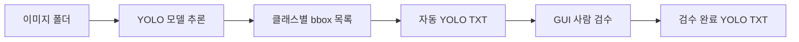

# YOLO 반자동 라벨링 MVP

학습된 YOLO 모델로 이미지의 bbox를 자동 생성하고, 사람이 GUI에서 bbox를
추가·조회·수정·삭제한 뒤 YOLO TXT로 저장하는 로컬 라벨링 도구입니다.

현재 클래스는 `person`과 건설장비 11종을 서로 구분합니다. 클래스마다 GUI의
bbox 색상이 다르며, 검수 결과는 이미지별 TXT 파일로 저장됩니다.

## 설치

```powershell
python -m venv .venv
.\.venv\Scripts\Activate.ps1
pip install -r requirements.txt
Copy-Item autolabel_config.example.yaml autolabel_config.yaml
```

`autolabel_config.yaml`에서 모델 경로와 이미지 폴더를 현재 PC 환경에 맞게
수정합니다. `.pt` 모델과 현장 이미지는 Git 저장소에 포함되지 않습니다.

## 실행

GUI 검수:

```powershell
python review_gui.py --config autolabel_config.yaml
```

폴더 전체 자동 라벨 생성:

```powershell
python auto_label.py --config autolabel_config.yaml
```

## 테스트

```powershell
python -m unittest test_auto_label.py test_review_labels.py test_review_gui.py
```

## 데이터 흐름


